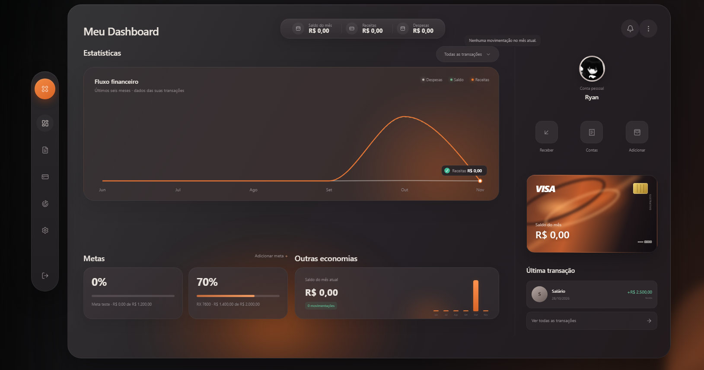
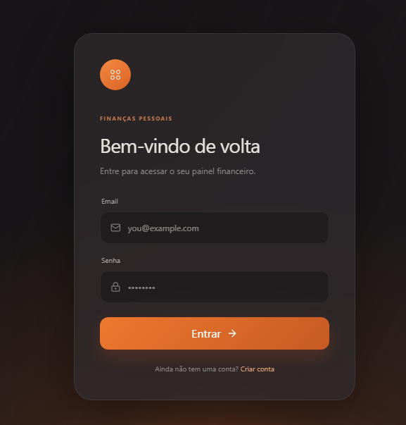

# Finance App

[](https://github.com/zRyann7/finance-app/actions/workflows/ci.yml)
[](LICENSE)

Painel de finanças pessoais: receitas e despesas, metas, contas recorrentes e resumo mensal. Aplicação full-stack com
React no frontend, API em Node/Express e Supabase (Auth, Postgres com RLS e Storage) como banco.

**🔗 Demo:** [finance-app-roan-iota.vercel.app](https://finance-app-roan-iota.vercel.app/login) · crie uma conta na tela de cadastro para explorar.

> **Primeiro acesso demorado?** O backend roda no plano gratuito do Render, que "dorme" depois de alguns minutos sem
> uso. A primeira requisição pode levar cerca de 1 minuto para acordá-lo. A tela de login dispara um `GET /health`
> assim que abre e mostra um aviso enquanto o servidor inicia.

## Telas

[](./docs/screenshots/dashboard.png)

<p align="center">
  <a href="./docs/screenshots/login.png">
    
  </a>
</p>

## Funcionalidades

- **Cadastro e login** com Supabase Auth, sessão com renovação automática do token e perfil com nome de usuário e foto (Supabase Storage).
- **Movimentações:** criar, editar e excluir receitas e despesas, filtrar por tipo e consultar o histórico completo.
- **Dashboard:** saldo, receitas e despesas do mês, gráfico de fluxo financeiro dos últimos seis meses e a última transação.
- **Metas financeiras** com barra de progresso e atualização do valor reservado.
- **Contas recorrentes** (vencimento mensal) que podem ser pausadas e reativadas, sem lançamento automático como pagas.

A tela de transferências internas existe apenas como área reservada e ainda não está implementada.

## Destaques técnicos

- **Segurança nos dados:** RLS em todas as tabelas (cada usuário só enxerga as próprias linhas) e privilégios mínimos para o papel anônimo. O backend usa apenas a chave publicável do Supabase junto com o token do usuário; a `service_role` nunca é usada.
- **Segurança na API:** rate limit por rota (cadastro, login e limite geral), CORS por lista de origens que é obrigatória em produção, validação de entrada e `trust proxy` configurável.
- **Segurança no frontend:** CSP gerada no build com as origens da API e do Supabase, e cabeçalhos de segurança no `vercel.json` e no nginx da imagem Docker.
- **Dinheiro e datas sem armadilhas:** valores somados em centavos com `BigInt` no backend e datas tratadas no fuso local, evitando o erro clássico do UTC que, no Brasil, já devolve o dia seguinte depois das 21h.
- **Plano gratuito sem tela quebrada:** o login tolera o *cold start* do Render (timeout maior, aviso "iniciando o servidor" e mensagens de erro específicas).
- **Acessibilidade:** diálogos próprios (sem `window.confirm`/`prompt`) com foco preso, Escape para fechar, `role="alertdialog"` e foco inicial em "Cancelar" nas exclusões.
- **Qualidade:** mais de 100 testes automatizados (backend com `node --test`, frontend com Vitest e Testing Library), CI no GitHub Actions, Dependabot semanal e migrations SQL versionadas.
- **Container:** imagens Docker com usuário não-root e `HEALTHCHECK`, mais um `docker-compose.yml` para uso local.

## Stack

| Parte | Tecnologias |
|---|---|
| `backend/` | Node 22, Express 5, Supabase (Auth + Postgres com RLS) |
| `frontend/` | React 19, Vite 8, Tailwind v4, React Router 8, Recharts, framer-motion |
| `backend/supabase/migrations/` | Schema, RLS, Storage e índices do banco |
| Hospedagem | Vercel (frontend), Render (backend) e Supabase (banco), todos em planos gratuitos |

## Rodando localmente

Requisitos: Node 22+ e um projeto no Supabase.

```bash
# 1) Banco: aplique as migrations de backend/supabase/migrations/ em ordem (veja "Banco de dados")

# 2) Backend (http://localhost:3000)
cd backend
cp .env.example .env        # preencha SUPABASE_URL e SUPABASE_KEY (chave publicável/anon)
npm ci
npm run dev

# 3) Frontend (http://localhost:5173)
cd frontend
cp .env.example .env        # preencha VITE_SUPABASE_URL e VITE_SUPABASE_ANON_KEY
npm ci
npm run dev
```

Com Docker: copie `backend/.env.example` para `backend/.env`, crie um `.env` na raiz com as `VITE_*` e rode
`docker compose up --build` (frontend em `localhost:8080`, API em `localhost:3000`).

## Variáveis de ambiente

**Backend** (`backend/.env`)

| Variável | Obrigatória | Descrição |
|---|---|---|
| `SUPABASE_URL`, `SUPABASE_KEY` | sim | URL do projeto e chave **publicável/anon**. Nunca use a `service_role`. |
| `CORS_ORIGINS` | **em produção** | Origens do frontend, separadas por vírgula. Sem ela o servidor não sobe com `NODE_ENV=production`. Em desenvolvimento, `localhost:5173` e `:8080` já são aceitos. |
| `TRUST_PROXY_HOPS` | não (padrão `1`) | Quantos proxies existem na frente do Express em produção. Use `0` sem proxy (ex.: compose local). |
| `NODE_ENV`, `PORT` | não | `production` ativa as regras de produção; porta padrão `3000`. |

**Frontend** (lidas no *build*, ficam dentro do bundle)

| Variável | Descrição |
|---|---|
| `VITE_API_URL` | Endereço da API, com ou sem o sufixo `/api` (o código normaliza). Padrão `http://localhost:3000`. |
| `VITE_SUPABASE_URL`, `VITE_SUPABASE_ANON_KEY` | Usadas só no upload de foto de perfil. Também alimentam a CSP gerada no build. |

## API

Tudo sob `/api`, exceto `GET /health`. Rotas marcadas com 🔒 exigem `Authorization: Bearer <access_token>`.

| Rota | Descrição |
|---|---|
| `POST /auth/register` · `POST /auth/login` · `POST /auth/refresh` | Cadastro (5/hora), login (10/15 min) e renovação de sessão |
| 🔒 `GET /auth/me` · `POST /auth/logout` | Usuário atual e encerramento da sessão |
| 🔒 `GET·POST·PATCH /profile` | Perfil (username e avatar) |
| 🔒 `GET·POST /transactions` · `PATCH·DELETE /transactions/:id` | Movimentações (a listagem devolve no máximo 500) |
| 🔒 `GET /summary?month=AAAA-MM` | Receitas, despesas e saldo do mês |
| 🔒 `GET /summary/history?end=AAAA-MM&months=6` | Totais por mês (1 a 12 meses), calculados sobre todas as transações |
| 🔒 `/goals` · `/bills` | CRUD de metas e de contas recorrentes |

Limite geral: 300 requisições por 15 minutos por IP.

## Banco de dados (Supabase)

Aplique em ordem os arquivos de `backend/supabase/migrations/`:

1. `…_create_profiles.sql` — tabela `profiles`, trigger de criação no cadastro e `is_username_available`.
2. `…170000_core_tables_baseline.sql` — `categories`, `transactions`, `financial_goals`, `recurring_expenses` e RLS (cada usuário só acessa as próprias linhas).
3. `…170100_avatars_storage_policies.sql` — bucket `avatars` (2 MB; JPG, PNG, WebP, GIF) e policies por dono.
4. `…170200_indexes_and_function_grants.sql` — índices por `user_id`/`date` e `revoke` da função de trigger.
5. `…170300_revoke_anon_core_tables.sql` — privilégios mínimos nas tabelas financeiras.

<details>
<summary>Nota sobre o projeto de produção e a CLI do Supabase</summary>

O projeto de produção já tem tudo isso. As migrations `170100`, `170200` e `170300` foram aplicadas pelo painel/MCP e
aparecem no histórico do Supabase com timestamps próprios; a `170000` não foi reaplicada porque as tabelas já existiam.
Se for adotar a CLI do Supabase, rode `supabase migration repair` antes do primeiro `db push`.

</details>

Ajustes manuais no painel do Supabase (não dá para fazer por SQL):

- **Auth → proteção contra senhas vazadas** (*leaked password protection*): ativar (pode depender do plano).
- **Auth → confirmação de e-mail**: o backend funciona com ela ligada ou desligada.

Avatares ficam em `avatars/<user_id>/<timestamp>.<ext>`. Ao trocar a foto, o arquivo antigo é apagado do bucket.

## Deploy

- **Frontend (Vercel):** defina `VITE_API_URL`, `VITE_SUPABASE_URL` e `VITE_SUPABASE_ANON_KEY` nas variáveis do projeto
  (valem para o *build*). O `vercel.json` já tem o rewrite de SPA e os cabeçalhos de segurança.
- **Backend (Render):** `NODE_ENV=production`, `SUPABASE_URL`, `SUPABASE_KEY`, `CORS_ORIGINS=https://seu-front.vercel.app` e,
  atrás de um único proxy/plataforma, `TRUST_PROXY_HOPS=1`. A imagem Docker roda como usuário não-root e tem `HEALTHCHECK` em `/health`.
- **Plano gratuito do Render:** o serviço hiberna sem tráfego. O frontend chama `GET /health` ao abrir login e cadastro para
  acordá-lo, e login e cadastro aceitam até 60 s de espera (o resto da API segue com 10 s).

## Testes e CI

```bash
cd backend  && npm test     # node --test (sem .env, sem Supabase)
cd frontend && npm test     # Vitest + Testing Library (fuso fixo America/Fortaleza)
```

O GitHub Actions (`.github/workflows/ci.yml`) roda os dois conjuntos de testes, o build do frontend e o build das duas
imagens Docker em cada push e pull request. O Dependabot abre PRs semanais de dependências.

## Convenções que já deram problema

- **Datas:** use `utils/date.js`. `new Date().toISOString().slice(0, 10)` devolve a data em UTC e, no Brasil, depois das 21h já é o dia (e às vezes o mês) seguinte.
- **Dinheiro:** use `formatMoney`/`parseBRL` de `utils/money.js`. No backend os valores são somados em centavos (`BigInt`).
- **CSS:** os estilos ficam em `frontend/src/styles/`, importados por `index.css`. O CSS próprio **não usa `@layer`**, então ele
  vence os utilitários do Tailwind v4 (um `fixed`/`z-[999]` no JSX perde para `position`/`z-index` definidos aqui) e a ordem dos
  imports importa: `responsive.css` deve ser sempre o último.
- **Popovers e diálogos:** feche com Escape e clique fora usando `hooks/useDismiss.js`; prenda o foco em diálogos com `hooks/useFocusTrap.js`.
- **Confirmações e entradas de texto:** use `useDialogs()` (`confirm` e `prompt`), que abre o diálogo do app. Não use `window.confirm`/`window.prompt`.
- **Segredos:** só a chave publicável/anon do Supabase aparece no projeto. `.env` nunca entra no Git nem na imagem Docker.

## Licença

Distribuído sob a licença MIT. Veja o arquivo [LICENSE](LICENSE).
